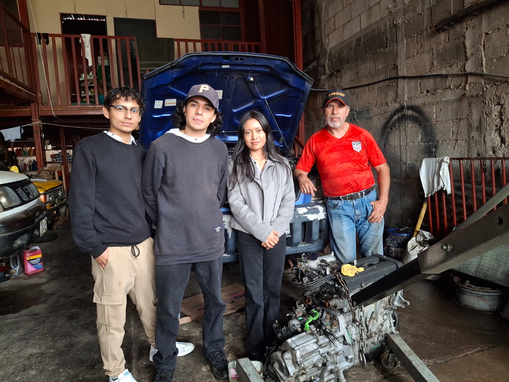

# Enlaces de los audios de las entrevistas y las fotografías del equipo con el entrevistado (o frente al negocio)

## Grupo 1 - 3 Integrantes  Aimar, Naomi y Dennis  
**Justificación y Descripción:**  
Entrevista realizada en el taller mecánico del familiar de Dennis. En este audio se recopila la información sobre el control operativo y los problemas diarios. La fotografía muestra al equipo realizando la visita presencial en el lugar.  

**Escuchar Entrevista 1:** 
[▶ Reproducir / Descargar Audio 1](media/AUD-20261010-WA0034.m4a)  

### Imagen  

## Grupo 2 - 2 Integrantes  Hassan y Carlos  
**Justificación y Descripción:**  
Entrevista realizada en una librería localizada  por Hassan y Carlos. El audio detalla las necesidades de registro y atención al cliente detectadas. La fotografía evidencia la presencia del equipo en el lugar entrevistado.

**Escuchar Entrevista 2:**  
[▶ Reproducir / Descargar Audio 2](media/05-10-2026%2011.45.m4a)  

### Imagen 

## EVIDENCIAS CON TIME.IS

### Grupo 5 completo Integrantes  Carlos, Hassan, Naomi, Dennis, Aimar.
**Grabacion**
Negociacion sobre propuestas a soluciones de lo que necesita don Rony en su negocio de taller de mecanica automotriz (autosemec).
Product Manager (Agresivo/Dominante) Carlos 
Se enfoca en el cumplimiento de fechas, costos y objetivos de negocio. Tiende a presionar al equipo para entregar lo antes posible. Reto: Transformar una comunicación agresiva en una comunicación firme pero respetuosa, defendiendo sus intereses sin afectar la relación con el equipo.
 
Tech Lead / Arquitecto (Racional/Técnico) Hassan
Prioriza la calidad del producto, la arquitectura y las buenas prácticas de desarrollo. Se opone a entregar soluciones incompletas o de bajo nivel. Reto: Negociar con flexibilidad sin comprometer la calidad crítica del sistema.
 
Cliente / Stakeholder (Pasivo-Agresivo) Aimar
Representa al cliente o usuario final. Puede cambiar requerimientos, mostrar inconformidades indirectas o falta de claridad en sus necesidades. Reto: Expresar necesidades de forma clara y reducir ambigüedades en los requerimientos
 
QA / Auditor (Analítico/Obstinado) Naomi
Se enfoca en identificar errores, riesgos y problemas. Tiende a rechazar entregas que no cumplen estándares. Reto: No limitarse únicamente a señalar fallas, sino también proponer soluciones viables
 
Scrum Master / Mediador (Asertivo) Dennis
Actúa como facilitador de la reunión. Su objetivo es mantener el orden, dar la palabra y promover una comunicación efectiva entre los participantes.
Reto: Lograr acuerdos tipo “win-win” y asegurar que todos los puntos de vista sean escuchados.
**Foto evidencia**
""

## CAPTURAS DE LOS PITCHS

**Pitch NO.02 - Naomi Axpuac**

**Descripción:** captura de pantalla tomada el 05/10/2026 a las , donde se ve el pitch individual recién subido s YouTube junto con la hora oficial de
time.is/es/Guatemala para validar cuándo se inició la planificación.

**Pitch NO.03 - Aimar Barrios**

